<h1 align = "center"> 🛡️ KumbhRakshak</h1>

<p align="center">


</p>

# AI-Based Policing Framework for Safety and Surveillance at Kumbh Mela

An intelligent crowd management and public safety platform designed for large-scale events like **Kumbh Mela**. KumbhRakshak combines **Artificial Intelligence, Computer Vision, Facial Recognition, and Real-Time Monitoring** to improve crowd safety, emergency response, and missing person identification.

🤝 **Project Sponsored By:** Ghoti Police Station

📄 **Research Paper Published in:** International Research Journal of Engineering and Technology (IRJET)

🌐 **Live Demo** - Coming Soon

💻 **GitHub Repository** - https://github.com/HarshMalode/KumbhRakshak

---

# 📸 System Preview

### 🏠 Home Page

<p align="center">
  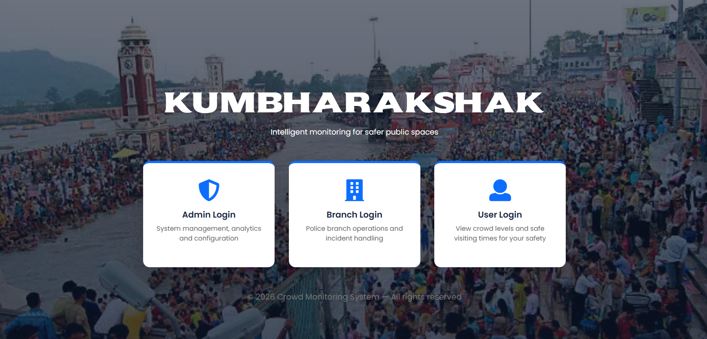
</p>

### 🛡️ Admin Dashboard

<p align="center">
  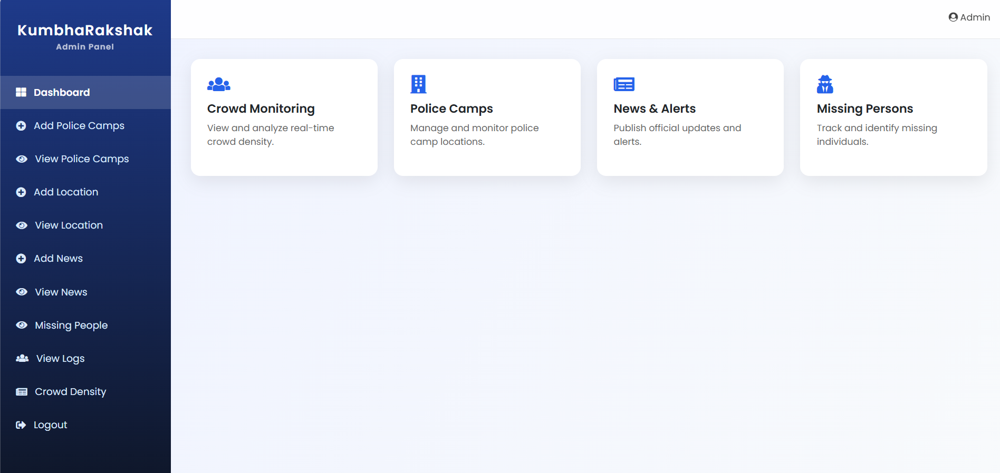
</p>

### 👮 Police Help Center Dashboard

<p align="center">
  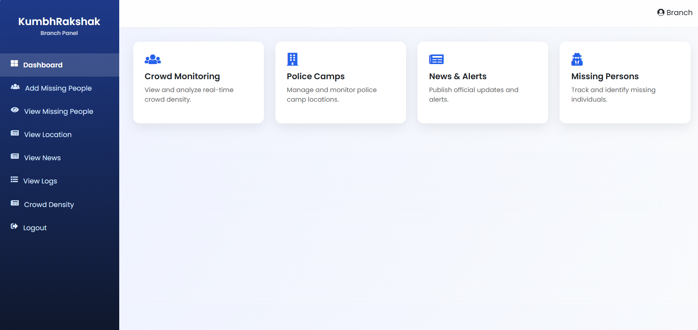
</p>

### 👤 User Dashboard

<p align="center">
  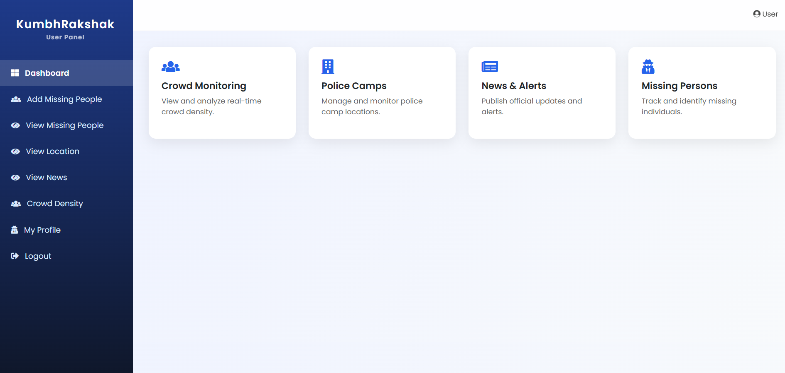
</p>

### 📊 AI Crowd Monitoring

<p align="center">
  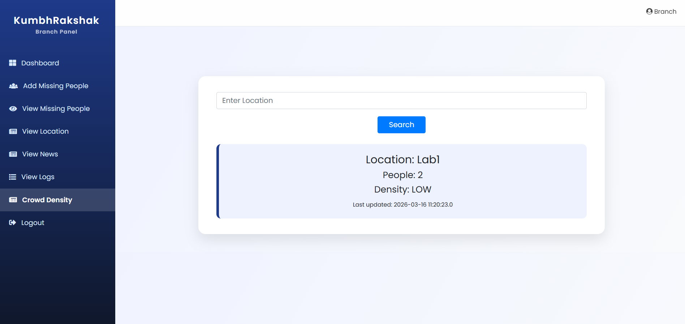
</p>

### 🧑‍🤝‍🧑 Missing Person Finder

<p align="center">
  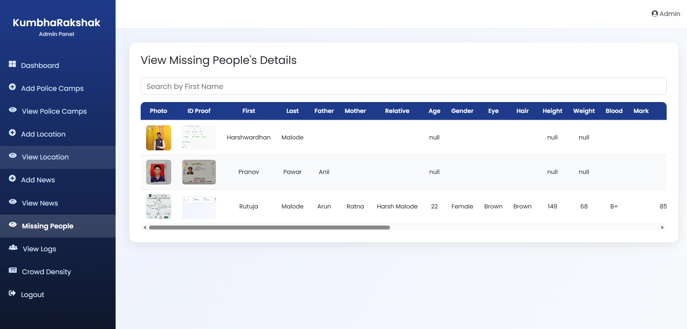
</p>

---

# 🚀 Why KumbhRakshak?

Managing millions of pilgrims during large religious gatherings presents major challenges such as:

- Crowd congestion
- Stampede prevention
- Missing person identification
- Emergency response
- Crowd flow management

KumbhRakshak provides an intelligent solution by integrating AI-powered surveillance with a centralized web application for authorities and pilgrims.

The platform helps improve public safety, enables faster emergency response, and enhances coordination among administrators, police personnel, and visitors.

---

# ✨ Features

## 👤 Pilgrim Module

Users can:

- Register & Login
- View important locations
- Receive navigation assistance
- View announcements
- Get emergency contact information
- Access safety guidelines

---

## 👮 Police Help Center Module

Police officers can:

- Secure Login
- Monitor crowd density
- Register missing person cases
- Perform AI-based facial recognition
- Receive real-time alerts
- Update missing person status
- Monitor CCTV surveillance

---

## 🛡️ Administrator Module

Administrators can:

- Manage event locations
- Manage Police Help Centers
- View crowd analytics
- Monitor system activities
- Manage users
- Generate reports
- Configure AI monitoring zones

---

# 🤖 AI Features

- ### Crowd Density Detection

      Detects crowd density using Computer Vision to identify highly congested zones and reduce the risk of overcrowding.

- ### Missing Person Finder

      Uses CNN-based Facial Recognition to compare captured faces with registered missing person records.

- ### Predictive Route Suggestion

      Analyzes crowd movement and recommends safer routes to reduce congestion.

- ### Emergency Alert System

      Automatically notifies authorities when abnormal crowd density or emergency situations are detected.

---

# 📊 Dashboard & Analytics

Interactive dashboards provide insights such as:

- Crowd Density Analysis
- Heat Map Visualization
- Missing Person Reports
- Alert Statistics
- Police Activity Logs
- Crowd Movement Trends

---

# 🛡 Security Features

The system follows secure development practices:

- Role-Based Authentication
- Secure Login
- Session Management
- Protected Dashboards
- Input Validation
- Database Security
- User Access Control

---

# 🛠 Technologies Used

## Frontend

- HTML5
- CSS3
- Bootstrap
- JavaScript

## Backend

- Java

## Artificial Intelligence

- Python
- OpenCV
- CNN
- Face Recognition

## Database

- MySQL

## Development Tools

- VS Code
- IntelliJ IDEA
- XAMPP
- Git
- GitHub

---

# 🧩 Project Structure

```
KumbhRakshak/
│
├── admin/
├── police/
├── user/
├── ai/
├── models/
├── uploads/
├── database/
├── screenshots/
├── assets/
├── index.php
├── login.php
├── register.php
└── README.md
```

---

# 📸 Screenshots

| Home | Admin Dashboard (Add Police Helpline) |
|------|---------------------------------------|
|  | 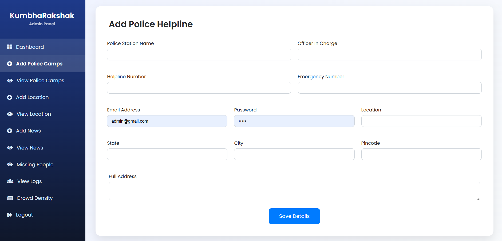 |

| Police Dashboard (Add Missing People) | User Dashboard (View Locations) |
|-----------------------------------|---------------------------------|
| 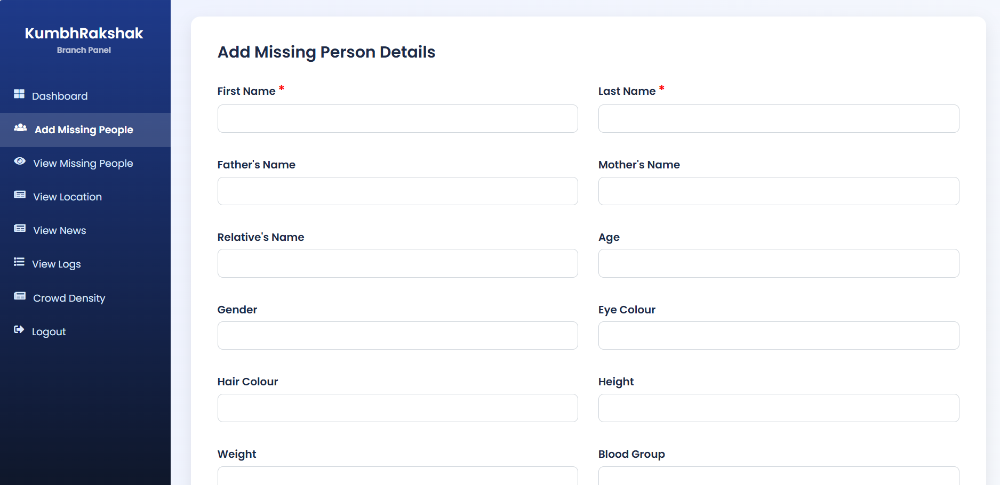 | 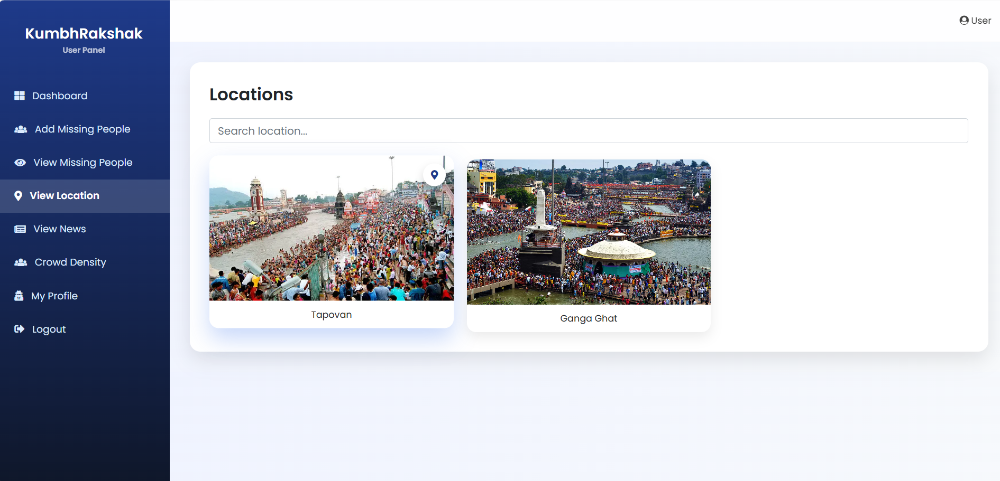 |

| Add & View News (User Safety) | Missing Person Finder (Detection) |
|-------------------------------|-----------------------------------|
| 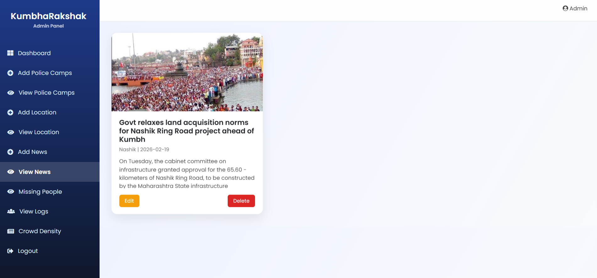 | 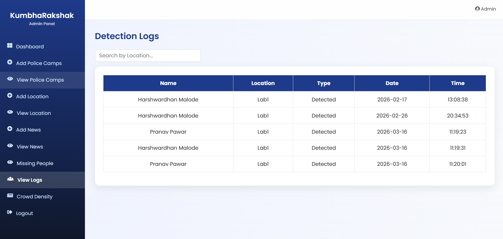 |

---

# 🌟 Applications

- Smart Crowd Management
- AI Surveillance
- Missing Person Identification
- Public Safety Monitoring
- Police Assistance
- Emergency Response
- Large Event Management
- Smart City Solutions

---

# 🚀 Installation

Clone the repository

```bash
git clone https://github.com/yourusername/KumbhRakshak.git
```

- Move the project into your server directory.

- Import the SQL database into MySQL.

- Start Apache and MySQL.

- Run the application or website.

         http://localhost:8080/KumbhRakshak/

---

# 🚧 Future Enhancements

- Mobile Application
- Live Drone Surveillance
- QR-Based Visitor Assistance
- AI-Based Stampede Prediction
- GPS Navigation
- SOS Mobile Alerts
- Multi-language Support
- Cloud Deployment

---

# 📄 Research Publication

**Title:** - *KumbhRakshak – Policing Framework for Safety and Surveillance at Kumbh Mela*

📚 Published in: **International Research Journal of Engineering and Technology (IRJET)**

---

# 🤝 Project Support

**Sponsored By** - Ghoti Police Station

---

# 🤝 Contributing

Contributions are welcome!

Feel free to:

- Fork the repository
- Create a feature branch
- Commit your changes
- Submit a Pull Request

---

# 📄 License

This project is licensed under the MIT License.

---

# 📬 Contact

👨‍💻 **Developed by:** Harshwardhan Malode

📧 Email:
harshwardhanmalode798@gmail.com

🔗 LinkedIn:
https://www.linkedin.com/in/harshwardhan-malode-226900386

🐙 GitHub:
https://github.com/harshwardhan951

🌐 Portfolio:
Coming Soon

---

# ⭐ If you found this project useful

⭐ Star this repository

🔁 Share it with others

💼 Connect with me on LinkedIn
